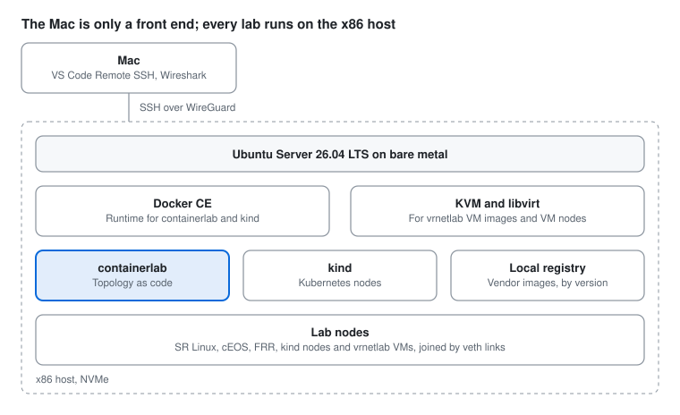

# Lab host setup

One x86 host runs every lab on bare metal: Linux, Docker CE, containerlab and kind, with KVM for vendor VM images. Your computer is only a front end, and nothing in a lab is exposed to the network the host is on; only lab 16 reaches outside, over its tunnels to a cloud VPC.

## Hardware

| Component | Choice | Why |
| --- | --- | --- |
| CPU | x86 with VT-x and VT-d (or AMD-V and AMD-Vi), enabled in the BIOS | vrnetlab images run QEMU with KVM inside their containers |
| Memory | The largest lab's need (about 28 GB) plus about 4 GB for the host; more for heavier vendor VMs or two labs at once | Each lab states its own RAM, from 4 to 28 GB, and runs one at a time |
| Storage | NVMe, 500 GB or more | Vendor images, kind node images and container layers add up quickly |
| Network | One wired NIC for management | Stable SSH; a second NIC or a VLAN can later connect labs to real gear |
| BIOS | Virtualization on; last state after AC loss | KVM support, and a host that was running comes back by itself after an outage |

## Operating system

- **Base packages:** iproute2, tcpdump, tshark, ethtool, iperf3, jq, git, and `qemu-kvm` with libvirt.
- **Updates:** unattended security upgrades; kernel updates and reboots happen between labs, not during one.

## Kernel and host tuning

| Setting | Value | Why |
| --- | --- | --- |
| KVM | `kvm_intel` (or `kvm_amd`) loaded, `/dev/kvm` present | Required by vrnetlab VM images |
| KSM | `/sys/kernel/mm/ksm/run` = 1, made persistent | Identical VMs share memory pages |
| Swap | zram, about 8 GB | A safety net so one oversized node doesn't trigger the OOM killer |
| inotify | `fs.inotify.max_user_watches` = 524288, `max_user_instances` = 512 | Multi-node kind clusters fail to start at the defaults |
| MPLS | `mpls_router` and `mpls_iptunnel` modules, `net.mpls.platform_labels` = 100000 | Linux-based nodes forwarding MPLS in lab 19 |
| Hugepages | Off by default; reserve them only for XRd vRouter | Avoids locking memory other labs need |

## Container runtime and lab tooling

| Tool | Role | Install from |
| --- | --- | --- |
| Docker CE | Container runtime for containerlab and kind | Docker's own package repository (not the distribution's package or a snap) |
| containerlab | Topologies as code; most labs run on it | Release binary; run with `sudo` |
| kind | Kubernetes clusters, used as `k8s-kind` nodes | Release binary |
| kubectl, Helm, cilium and hubble CLIs | Cluster and Cilium management | Release binaries |
| netlab | Generates routing configs for containerlab from a short topology | pip |
| vrnetlab (hellt fork) | Packages vendor VM images as containers | git, built locally |
| libvirt and QEMU | Full VM nodes when per-node kernels matter | Distribution packages |
| Local Docker registry | Keeps built vendor images, tagged by version | A registry container on the host |
| Edgeshark and gnmic | Packet capture from VS Code; gNMI telemetry and config | Containers / release binary |

## Networking and access

- **Host access:** SSH with keys only, to a fixed address on the wired NIC.
- **Lab management:** each lab gets containerlab's management bridge (172.20.20.0/24 by default); node consoles and SSH are reached from the host or the VS Code extension.
- **Lab traffic:** stays on veth links between nodes. Outbound internet for package installs goes through Docker's NAT.
- **Later, real gear:** a spare NIC or VLAN can attach a lab to physical devices through containerlab host or macvlan links.

## Front end

VS Code connects to the host over Remote SSH and runs the Containerlab extension there: TopoViewer to draw and run topologies, and Edgeshark with Wireshark on your computer for packet capture on any link.

## Tool choices

- **containerlab** for every lab with a network fabric: labs 2–6, 9–11, 13, 14, 16 and 18–23, and optionally 12, 15 and 24; k8s-kind clusters plug into it as nodes.
- **kind alone** where there's no fabric: labs 0, 1, 7 and 8, and most of 12, 15 and 24.
- **libvirt VMs** as the nodes themselves in lab 17, for lab 14's data transfer node, and for lab 22's Soft-RoCE hosts.
- **netlab** on top of containerlab once routing configs get repetitive.
- **libvirt VMs** running kubeadm or k3s, wired into containerlab over Linux bridges, when per-node kernel behavior matters (kernel tuning, some eBPF and WireGuard tests). All kind nodes share the host's kernel.

## Repository and capacity

- **One git repo:** a folder per lab (`labs/03-leaf-spine/`) holding the topology file, device configs, Kubernetes manifests and a README; a `shared/` folder for kind configs and Cilium Helm values.
- **One lab at a time:** labs need 4–28 GB; keep about 4 GB free for the host. Tear down with `containerlab destroy --cleanup` before deploying the next.
- **Housekeeping:** prune unused images monthly; vendor images stay safe in the local registry.

## Automation

Each lab's **Automation** line follows the closest real environment that has published how it works; where that environment hasn't published its tooling, the lab uses the nearest documented practice. Public sources describe tools and patterns, not internal details, so treat each as the nearest documented practice rather than a copy of that organization's setup.

- **Host:** one Ansible playbook builds the host (packages, tuning, Docker CE, lab tools), so the host can be rebuilt from scratch.
- **Common layer:** everything in one git repo; a self-hosted GitHub Actions runner on the host; Helm for every in-cluster component; Argo CD in each cluster from lab 6 on.
- **Device configs:** netlab or Jinja templates rendered by Python and Nornir, pushed over gNMI, unless a lab below says otherwise.
- **Public repo:** this repo is public, so the self-hosted runner must not be attached to it directly: a pull request from anyone would run code on the lab host. Attach the runner to a private mirror of the repo, and keep GitHub-hosted runners for anything that runs here.

## Related

- [Getting the images](images.md): which network OS images pull freely and which need a vendor account.
- [Published labs, platforms and alternatives](alternatives.md).
- [References](references.md).
