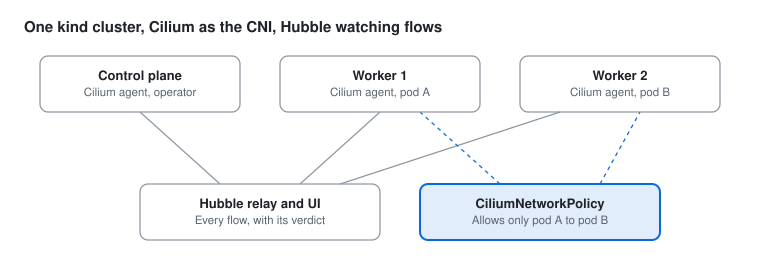

# Lab 1: Kind and Cilium

[All labs](../../README.md) · [Notes](NOTES.md)

Fit: both · about 4 GB · no containerlab. One kind cluster with Cilium as the CNI teaches the networking basics every later lab builds on.

- **Build:** a 3-node kind cluster with kind's default CNI disabled, then `cilium install` and `cilium hubble enable --ui`.
- **Learn:** how Cilium gives pods addresses and routes between nodes, what security identities and policy verdicts look like, and how to read flows in Hubble.
- **Automation:** like [ESnet's production Kubernetes](https://www.cncf.io/case-studies/esnet-energy-sciences-network/), which runs Cilium as CNI, load balancer, ingress and Gateway API with Hubble (its provisioning tooling isn't published). Here: kind config and Cilium Helm values in git, applied by a script.

1. Run `cilium status` and `cilium connectivity test`.
2. Deploy pods A and B on different workers and watch their traffic in Hubble.
3. Apply a CiliumNetworkPolicy that allows only A to B on one port; confirm other traffic shows as dropped.
4. Restart a Cilium agent and watch what happens to existing connections.

**Published labs:** Isovalent's free [Getting Started with Cilium](https://cilium.io/labs) is the guided browser version. The [iximiuz Kubernetes playground](https://labs.iximiuz.com/playgrounds/k8s-omni) gives a kubeadm cluster of real VMs that can start with no CNI, so you install Cilium yourself. **Differs:** both are sessions that end; this one is built from a kind config and Helm values kept in git, so you can tear it down and rebuild it in minutes. Later labs create their own clusters from those same files rather than keeping this one running, which is why it is plain kind.
