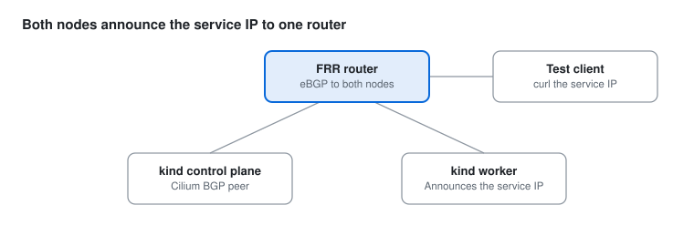

# Lab 2: One router and kind

[All labs](../../README.md) · [Notes](NOTES.md)

Fit: both · about 5 GB · the smallest containerlab topology. A single FRR router gives the cluster something to announce routes to.

- **Build:** a containerlab topology with one `linux` FRR node, a test client and a 2-node `k8s-kind` cluster wired in as `ext-container` nodes; Cilium with its BGP control plane enabled.
- **Learn:** Cilium's BGP cluster and peer configuration, LoadBalancer IP pools, and how a service IP shows up as a BGP route.
- **Automation:** ESnet again: its worker nodes peer with leaf switches automatically when they join, and Cilium's load balancer IPAM gives each app an IPv6 /64 that BGP advertises. Here: one cluster-wide BGP config in git.

1. Peer both nodes with FRR and check `show bgp summary` on the router.
2. Create a LoadBalancer service and find its /32 in FRR's routing table.
3. Curl the service from the client, then stop one node and watch its route withdraw.

**Extend:** rebuild the lab dual-stack, then IPv6-only as ESnet runs its clusters, and check that BGP carries both address families.

**Published labs:** Cilium's own [BGP control plane lab](https://docs.cilium.io/en/latest/contributing/development/bgp_cplane/) is nearly this lab. One FRR router (AS 65000) peers with two kind nodes (AS 65001), a netshoot container stands outside the cluster, and services are advertised over IPv4 and IPv6; `make kind-bgp-service` starts it. Isovalent's [BGP on Cilium](https://isovalent.com/labs/cilium-bgp) is the guided browser version, ending in an exam. Cilium's repo keeps four such labs in [contrib/containerlab](https://github.com/cilium/cilium/tree/main/contrib/containerlab): `service`, `pod-ip-pool`, `multi-homing` and `auto-discovery`. Each runs with `make deploy`, `make destroy` and `make reload`, with Cilium pinned to the latest stable release unless `VERSION` overrides it. **Differs:** Cilium's lab reaches each kind node through a netshoot container sharing its network namespace; this lab cables `k8s-kind` nodes directly, the pattern every later fabric lab reuses. Theirs is dual-stack from the start; here IPv6 waits for Extend so the first pass has one address family to debug.
