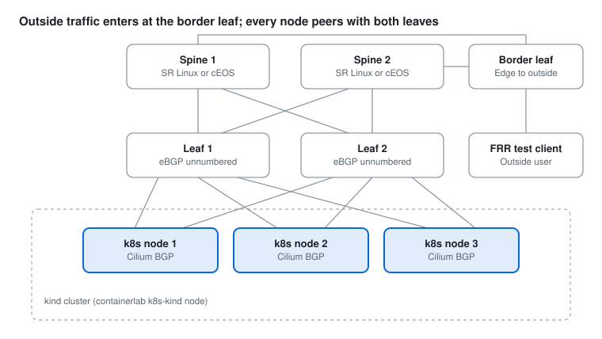

# Lab 3: Leaf-spine with Cilium BGP

[All labs](../../README.md) · [Notes](NOTES.md)

Fit: both · 12–14 GB · the first full fabric; most later labs reuse it.

Each node peers with both leaves and advertises its pod CIDR and LoadBalancer service IPs; the FRR client, behind the border leaf, sees each service IP over equal-cost paths through both spines. It models bare-metal Kubernetes in a routed data center: BGP to the host instead of MLAG, and service IPs announced without a cloud load balancer.

- **Build:** two SR Linux or cEOS spines and two leaves with eBGP unnumbered, a border leaf on both spines with an FRR client behind it as the outside world, and a 3-node `k8s-kind` cluster with every node cabled to both leaves; Cilium's BGP control plane peers with both leaves.
- **Learn:** BGP to the host, ECMP to service IPs, how routes withdraw on failure, and how traffic policy decides which nodes announce a service.
- **Automation:** like [Preferred Networks](https://www.cncf.io/case-studies/preferred-networks-2/), whose 300+ node AI cluster uses one Cilium BGP peering policy for every node, so new nodes need no BGP changes. Here: netlab-generated switch configs and one BGP policy delivered by Helm.

1. Deploy the fabric with eBGP unnumbered, then the kind cluster with Cilium's BGP control plane.
2. Expose a test deployment as a LoadBalancer service and reach it from the FRR client.
3. Break things: shut a spine, a leaf, one node-to-leaf link, or a node, and watch routes withdraw and ECMP converge.
4. Compare `externalTrafficPolicy: Local` vs `Cluster`, and add BFD to see how failover time changes.

**Verify:** one check per exercise, same numbers; load the helpers first with `source ../../shared/verify.sh lab03` (see [verifying a lab](../../docs/verify.md)).

1. `srl leaf1 "show network-instance default protocols bgp neighbor"` shows every session `established` on each switch, and `cilium bgp peers` shows two established sessions per node.
2. `SVC_IP=$(svc_ip demo web); srl border "show network-instance default route-table ipv4-unicast prefix $SVC_IP/32"` shows two next hops, and `on client curl -s -m 3 -o /dev/null -w '%{http_code}\n' http://$SVC_IP` prints `200`.
3. Leave `while :; do on client curl -s -m 1 -o /dev/null -w '%{http_code}\n' http://$SVC_IP; sleep 0.2; done` running. For each of the four failures it returns to `200` without help, and the route-table command from check 2 no longer lists the failed path.
4. `kubectl -n demo get svc web -o jsonpath='{.spec.externalTrafficPolicy}'` prints the policy under test. With `Local`, the next hops for the service route are only the nodes that `kubectl -n demo get pods -o wide` shows running a pod. `srl leaf1 "info from state bfd"` lists the BFD sessions, and `NOTES.md` has the failover time with and without BFD. Open-source Cilium may not support BFD on its own sessions; if your version doesn't, measure on the leaf-to-spine sessions.

It shows design and failure behavior, not performance or scale: everything is software on one host.

**Published labs:** Nokia's [srl-k8s-anycast-lab](https://github.com/srl-labs/srl-k8s-anycast-lab) is the closest: an SR Linux fabric of 2 spines and 4 leaves, a 3-node Minikube cluster, and four Linux clients load-balanced across nginx pods. **Differs:** it announces services with MetalLB in BGP mode and uses EVPN anycast gateways on the leaves; this lab uses Cilium's BGP control plane over eBGP unnumbered, with the client behind a border leaf. Cilium BGP is what ESnet and Preferred Networks run, and leaving EVPN out keeps it for lab 4. Their four clients are worth copying to see per-flow ECMP spread. Cilium's own `multi-homing` and `auto-discovery` labs (see lab 2) are the Cilium-maintained pieces closest to this lab; read their topology files before writing your own.
