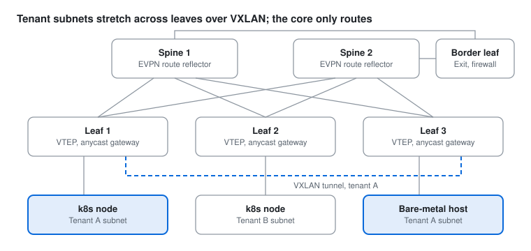

# Lab 4: EVPN-VXLAN fabric

[All labs](../../README.md) · [Notes](NOTES.md)

Fit: both · 14–18 GB · builds on lab 3. This is the most common modern data center design: tenant networks carried as VXLAN over a plain routed core, with EVPN as the control plane.

- **Build:** SR Linux or cEOS, with 2 spines as EVPN route reflectors and 3 leaves as VTEPs using symmetric IRB and anycast gateways, and a border leaf for traffic leaving the fabric; a MAC-VRF and IP-VRF per tenant; kind nodes and a plain `linux` host attached to tenant networks. Generate configs with netlab, or with Arista's AVD on cEOS.
- **Learn:** underlay vs overlay, EVPN route types 2 and 5, layer 2 vs layer 3 VNIs, anycast gateways, and EVPN multihoming as the alternative to MLAG.
- **Automation:** like [Arista Validated Designs](https://avd.arista.com/5.5/ansible_collections/arista/avd/examples/single-dc-l3ls/index.html), an Ansible collection that generates EVPN/VXLAN fabric configs from data models. Here: AVD data models rendering cEOS configs (netlab for SR Linux), deployed through lab 10's pipeline.

1. Bring up the eBGP underlay, then the EVPN overlay; find the type-2 and type-5 routes on each leaf.
2. Stretch tenant A's subnet across leaves 1 and 3, ping across it, and capture the VXLAN packets in Edgeshark.
3. Route between tenants only through a firewall container on a border leaf.
4. Dual-home a host to two leaves with EVPN multihoming and fail one link.
5. Peer Cilium into tenant A's VRF so its service IPs exist only in that tenant.

**Published labs:** Nokia's [nokia-evpn-lab](https://github.com/srl-labs/nokia-evpn-lab) and [multivendor-evpn-lab](https://github.com/srl-labs/multivendor-evpn-lab) are containerlab EVPN fabrics. Arista's [CI/AVD L3LS EVPN/VXLAN workshop](https://labguides.testdrive.arista.com/2024.3/automation/ci_avd_l3ls/overview/) builds two sites with EVPN gateways and border leaves from AVD data models, on Arista Test Drive ([repo](https://github.com/aristanetworks/ci-workshops-avd)). NVIDIA Air's [demo marketplace](https://docs.nvidia.com/networking-ethernet-software/guides/EVPN-Network-Reference/Additional-Information) has ready EVPN symmetric routing, centralized routing, multihoming and L2 extension labs on Cumulus Linux. **Differs:** all of them stop at the fabric. This lab attaches kind nodes, peers Cilium into a tenant VRF and routes between tenants through a firewall, because the Kubernetes edge is the part the target jobs add. Start from the AVD workshop's data model, and use Air to compare a second vendor's EVPN without spending host RAM.
