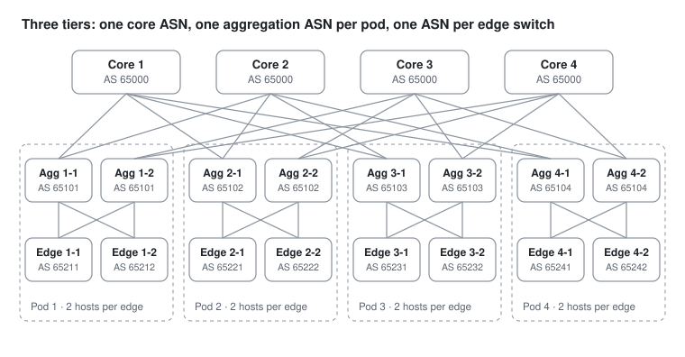

# Lab 5: Fat-tree design and BGP at scale

[All labs](../../README.md) · [Notes](NOTES.md)

Fit: both · about 6 GB · builds on lab 3. Lab 3's fabric has two tiers and four switches, which hides the problems that shape real designs: how many tiers a port count needs, how ASNs are laid out, and what ECMP and summarization do when a link fails. This lab uses FRR for every switch so a three-tier fabric fits in memory.

- **Build:** a k=4 fat-tree of 20 FRR `linux` nodes (4 core, 8 aggregation, 8 edge in 4 pods) with eBGP unnumbered, and 16 small Linux hosts, two per edge switch. Generate the topology file and configs from one script that takes k, so the ASN scheme and the summaries can be changed and redeployed in a minute.
- **Learn:** Clos and fat-tree arithmetic (ports, tiers, oversubscription), the [RFC 7938](https://www.rfc-editor.org/rfc/rfc7938) ASN layout and why it limits path hunting, where `multipath-relax` and `allowas-in` are needed, how summarization creates blackholes, ECMP hashing, polarization and low-entropy flows, and draining a switch without loss.
- **Automation:** like RFC 7938, written by engineers who ran BGP-only fabrics at Facebook and Microsoft, and [Meta's data center fabric](https://engineering.fb.com/2014/11/14/production-engineering/introducing-data-center-fabric-the-next-generation-facebook-data-center-network/), where every pod is the same unit and the config is generated from the design. Here: a netlab topology generated from k, with FRR configs rendered from it.

1. On paper first: size a non-blocking fabric from 64-port switches for 1,024 host ports, then for 8,192. Count tiers, switches, links and optics for each, then redo both at 2:1 oversubscription at the edge. Check the answers against the fat-tree limit of k³/4 hosts for k-port switches.
2. Deploy the k=4 fabric with one ASN for the core, one per pod for aggregation, and one per edge switch. Count the equal-cost paths between two hosts in different pods and confirm them in the routing table. Find where ECMP needs `bgp bestpath as-path multipath-relax` and where it doesn't.
3. Measure path hunting: withdraw one host prefix and count the BGP UPDATE messages across the fabric. Redeploy with a unique ASN on every switch and compare.
4. Reuse the same edge ASNs in every pod, see which routes disappear, and fix it with `allowas-in`. Write down what the reuse buys and what it costs when debugging.
5. Summarize each pod's host prefixes at its aggregation switches, fail one edge-to-aggregation link, and find the blackhole. Explain why the aggregation switch has no other path, then decide what to summarize instead.
6. Run 16 iperf3 flows between two pods and read per-link counters to see the spread. Switch `fib_multipath_hash_policy` between layer 3 and layer 4 and compare. Then send four large flows that differ only in UDP source port, as RoCE flows do, and count how often two share a link.
7. Look for polarization: check whether the flows an edge switch sends up one link all take the same core link at the next tier. FRR containers share the host kernel and, on most kernels, its hash seed, so it tends to show up without setup. Change the seed or hash fields per tier where the kernel allows it (`fib_multipath_hash_seed` on newer kernels) and measure again.
8. Drain a core switch for maintenance with `bgp graceful-shutdown` while a transfer runs; confirm zero loss, then compare with shutting it down cold.

**Verify:** one check per exercise, same numbers; load the helpers in [shared/helpers.sh](../../shared/helpers.sh) first with `source ../../shared/helpers.sh lab05` (see [verifying a lab](../../docs/verify.md)).

1. No command. `NOTES.md` has the counts for all four designs. Non-blocking, 1,024 ports fit two tiers with 48 switches (32 leaves, 16 spines); 8,192 ports need three tiers with 640 switches (256 edge, 256 aggregation, 128 core).
2. `frr edge1-1 "show ip route $FAR_HOST_PREFIX"` shows two next hops, and the same command on `agg1-1` shows two more, which makes four paths between pods. `NOTES.md` says where `multipath-relax` was needed.
3. `frr core1 "show bgp summary"` before and after the withdrawal gives the change in `MsgRcvd`; sum it across the switches. `NOTES.md` has the total for both ASN schemes, and the unique-ASN total is the larger.
4. With edge ASNs reused, `frr edge2-1 "show bgp ipv4 unicast"` is missing the prefixes of the edge switch that shares its ASN. After `allowas-in` they are back and `on h1 ping -c 3 $FAR_HOST_IP` succeeds.
5. With the link failed, `on h1 traceroute -n $FAR_HOST_IP` stops at the aggregation switch that lost the link for the flows hashed to it, and `frr agg3-1 "show ip route $FAR_HOST_PREFIX"` on that switch shows no specific route. After you change the summarization, the same traceroute completes.
6. `on edge1-1 sysctl net.ipv4.fib_multipath_hash_policy` shows the policy under test, and `on edge1-1 ip -s link show eth1` (and `eth2`) gives bytes per uplink. `NOTES.md` has the split for both policies, and how many of the four UDP flows shared a link.
7. `on agg1-1 ip -s link show eth1` and `eth2` during the test: if one core uplink carries nearly all the bytes arriving from one edge uplink, the fabric is polarized. `NOTES.md` has the split before and after the change.
8. `on h1 ping -i 0.01 -c 3000 $FAR_HOST_IP` reports 0% loss across the graceful drain and more than 0% across the cold shutdown, and `frr core1 "show bgp summary"` confirms the sessions' state each time.

**Extend:** layer 1 can't be simulated, so do it on paper and on any real NIC. For the 8,192-port design in exercise 1, pick DAC, AOC or optics for each tier by distance, plan the breakouts, and note which FEC each link type needs. On the lab host's own NIC, read the module with `ethtool -m`, the FEC mode with `ethtool --show-fec`, and the error counters with `ethtool -S`.

**Published labs:** ipSpace's [BGP labs](https://bgplabs.net/) are open-source hands-on exercises built on [netlab](https://netlab.tools/), covering sessions, policy and scaling features one at a time. **Differs:** each of those isolates one feature on a few routers. This lab puts them on one three-tier fabric, where the ASN layout, summarization and ECMP interact and a single link failure shows the result. Do the ipSpace exercises for any feature that is new, then come back. The fat-tree itself is from [Al-Fares et al.](http://ccr.sigcomm.org/online/files/p63-alfares.pdf), which is worth reading before exercise 1.
