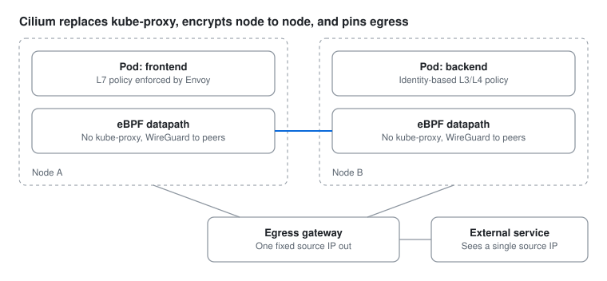

# Lab 6: Cilium in depth

[All labs](../../README.md) · [Notes](NOTES.md)

Fit: both · 13–15 GB · builds on lab 3. This covers most of what interviewers ask about Cilium.

- **Build:** reinstall Cilium on lab 3 with kube-proxy replacement and native routing, then turn on WireGuard encryption, an L7 policy and an egress gateway node, with a test external service behind lab 3's border leaf.
- **Learn:** how eBPF replaces kube-proxy, native routing vs VXLAN tunnels, identity-based and L7 policy, the cost of encryption, and fixed egress IPs for outside firewalls.
- **Automation:** like [Celonis](https://www.cncf.io/case-studies/celonis/), which runs L7 and FQDN policy, Cluster Mesh, Hubble and WireGuard across 150+ clusters (deployment tooling not published). Here: Argo CD syncing Cilium Helm values and policies from git.

1. Confirm there are no kube-proxy iptables rules and services still work.
2. Switch between native routing and VXLAN; compare MTU, packet captures and the BGP routes.
3. Write an L7 policy that allows only `GET /health` from frontend to backend.
4. Enable WireGuard and check in Edgeshark that node-to-node traffic is encrypted.
5. Send one namespace's outbound traffic through the egress gateway and check the source IP the external service sees.

**Verify:** one check per exercise, same numbers; load the helpers first with `source ../../shared/verify.sh lab03` (see [verifying a lab](../../docs/verify.md)).

1. `kubectl -n kube-system get ds kube-proxy` returns `NotFound`, `cil status | grep KubeProxyReplacement` prints `True`, `docker exec k8s-worker iptables-save | grep -c KUBE-SVC` prints `0`, and the service still answers from the client.
2. `cilium config view | grep -E 'routing-mode|tunnel-protocol'` shows the mode under test. `kubectl -n demo exec deploy/web -- cat /sys/class/net/eth0/mtu` differs between the two modes by the VXLAN overhead, and in tunnel mode `cap leaf1 -i e1-1 udp port 8472 -c 5` shows pod traffic encapsulated.
3. `kubectl -n demo exec deploy/frontend -- curl -s -o /dev/null -w '%{http_code}\n' http://backend/health` prints `200`, and the same request to any other path, or with `-X POST`, prints `403`.
4. `cil encrypt status` shows `Wireguard` with one peer per other node, and `cap leaf1 -i e1-1 udp port 51871 -c 5` shows node-to-node traffic as WireGuard with no readable HTTP.
5. `kubectl get ciliumegressgatewaypolicies` lists the policy, and a request from the namespace to the external service arrives from the egress IP: check the service's access log, or `cap border -i e1-1 host $EGRESS_IP -c 3`.

**Extend:** add Tetragon for eBPF runtime security, and alert when a pod runs an unexpected binary or opens an unexpected connection.

**Published labs:** Isovalent's browser labs cover each feature alone: [Advanced BGP Features](https://isovalent.com/labs/cilium-bgp-advanced) (timers, graceful restart, MD5), the [Cloud Network Engineer discovery lab](https://isovalent.com/labs/discovery-cloud-network-engineer) (dual stack, BGP, LB-IPAM, egress gateway), and, for Extend, [Getting Started with Tetragon](https://isovalent.com/labs/tetragon-getting-started), whose free badge has you install Tetragon on kind and trace a lateral attack. **Differs:** each runs one feature on a fresh cluster. Here they run together on lab 3's routed fabric, so native routing depends on real BGP routes and the combined MTU and policy effects show up in captures. Do their labs first for the feature, then this one for the interactions.
