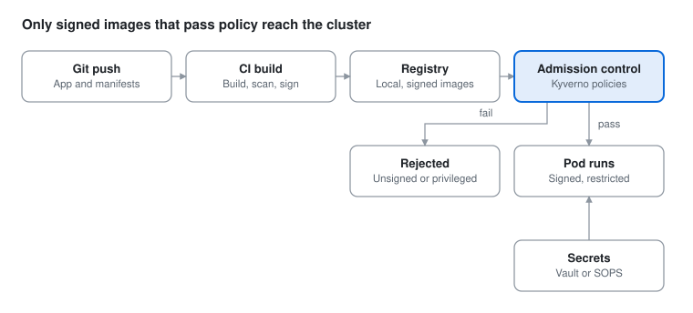

# Lab 6: Cluster security and supply chain

[All labs](../../README.md) · [Notes](NOTES.md)

Fit: AI, useful for both · about 6 GB · kind only. Anthropic's cluster infrastructure postings list pod security and admission control, RBAC and least-privilege IAM, node and container hardening, and image provenance ([posting](https://gorodeo.app/job/staff-infrastructure-engineer-cluster-infrastruct-l7JbXpme-ElBmLTn-bHsyw)).

- **Build:** a kind cluster with Kyverno (or OPA Gatekeeper), pod security admission set to `restricted`, a local registry, cosign signing in GitHub Actions, a Kyverno image-verification policy, Vault or SOPS for secrets, and one namespace-scoped RBAC role per "team".
- **Registry and runner:** GitHub-hosted runners can't reach a registry on the lab host. Either run the signing job on the host's self-hosted runner ([host setup](../../docs/host-setup.md#automation)), or push to GHCR and skip the local registry. With the local registry, attach it to the kind network and add it to the kind nodes' containerd config, so the runner, the nodes and Kyverno all reach it under the same name; a signature made for one name won't verify under another.
- **Learn:** admission control, pod security standards, least privilege, image signing and verification, and keeping secrets out of git.
- **Automation:** Anthropic's postings pair these controls with infrastructure as code. Here: Kyverno policies, pod security labels and RBAC roles synced by Argo CD, and cosign signing in GitHub Actions.

1. Enforce `restricted` pod security and watch a privileged pod get rejected.
2. Sign images in CI with cosign and require valid signatures with a Kyverno policy.
3. Give a team a namespace-scoped role and prove it can't read another namespace's secrets.
4. Deliver a database password from Vault or SOPS without it ever sitting in git in plain text.
5. Run kube-bench against the cluster and fix the top findings.
