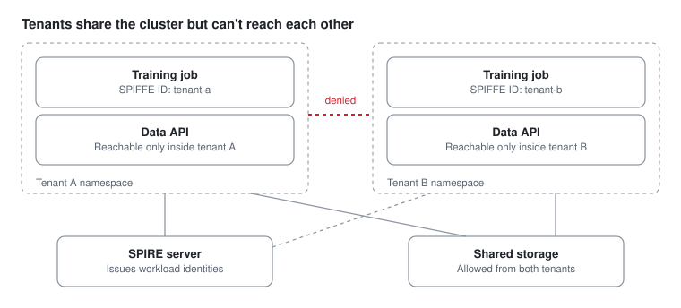

# Lab 7: Multi-tenant isolation

[All labs](../../README.md) · [Notes](NOTES.md)

Fit: AI · about 8 GB · kind only; reuses lab 5's Cilium settings and lab 6's policies, not lab 3's fabric. One team's jobs must not reach another's, even on shared nodes.

- **Build:** a 3-node kind cluster with Cilium installed from lab 5's Helm values (kube-proxy replacement, WireGuard available) and lab 6's admission policies; in it, two tenant namespaces with default-deny policies, SPIRE issuing SPIFFE identities, Cilium mutual authentication or WireGuard for pod traffic, and one shared storage service both tenants may use.
- **Learn:** default-deny design, identity-based access, and keeping shared services reachable without opening tenants to each other.
- **Automation:** like [Uber](https://www.uber.com/blog/our-journey-adopting-spiffe-spire), which runs SPIRE across four clouds, with registrant services defining workload identities and certificates rotating automatically. Here: the SPIRE Helm chart, with identities declared as Kubernetes resources and synced by Argo CD.

1. Apply default deny in both namespaces and confirm nothing crosses.
2. Allow both tenants to reach shared storage, and nothing else.
3. Issue SPIFFE IDs with SPIRE and require them for the storage API.
4. From tenant A, try to reach tenant B with a copied pod label and confirm it's still blocked.

**Published labs:** Isovalent's [Mutual Authentication with Cilium](https://cilium.io/labs/2) lab covers Cilium's mutual auth on its own. **Differs:** this lab runs SPIRE explicitly, with two default-deny tenants and one shared storage service, because that is the shape of a multi-team AI cluster and the hard part is keeping the shared service open without opening tenants to each other.
