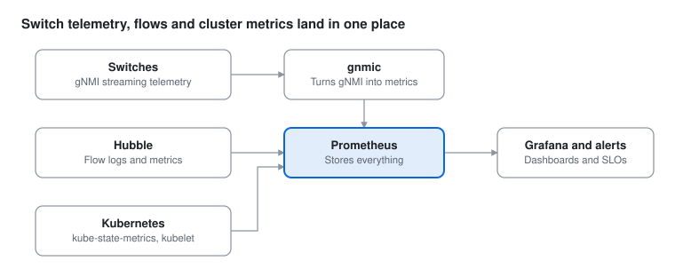

# Lab 9: Monitoring pipeline

[All labs](../../README.md) · [Notes](NOTES.md)

Fit: both · 16–18 GB · uses lab 3's fabric. Both kinds of employer run operations off a stack like this.

- **Build:** gnmic subscribed to the SR Linux or cEOS switches, Hubble metrics, and kube-prometheus-stack, with Grafana dashboards and Alertmanager rules, plus Promtail and Loki for switch syslog and pod logs.
- **Learn:** streaming telemetry vs polling, joining network and cluster data in one view, and alerting on symptoms and SLOs.
- **Automation:** like [NERSC Omni](https://hpc-oda-org.pages.dev/techtalk/2026-03-12-techtalk-romanus/): hundreds of monitoring nodes and 17 Kubernetes clusters, with [Prometheus, Grafana and ServiceNow](https://escholarship.org/content/qt7ch6t25w/qt7ch6t25w.pdf?t=rr0fgb) for alerting. Here: kube-prometheus-stack and gnmic by Helm, with an Alertmanager webhook opening tickets in a stand-in queue.

1. Stream interface counters and BGP state from every switch.
2. Build one dashboard showing a link, its BGP session and the pod flows that cross it.
3. Alert when a BGP session drops or interface errors rise; trigger it by shutting a link.
4. Define a success-rate SLO for lab 3's service and watch a failure burn it.

**Verify:** one check per exercise, same numbers; load the helpers first with `source ../../shared/verify.sh lab03` (see [verifying a lab](../../docs/verify.md)). The checks query Prometheus through `kubectl -n monitoring port-forward svc/prometheus-operated 9090 &`.

1. `curl -s localhost:9090/api/v1/label/source/values | jq .data` lists every switch, and `curl -s localhost:9090/api/v1/targets | jq -r '.data.activeTargets[] | "\(.labels.job) \(.health)"' | sort | uniq -c` shows the gnmic and Hubble targets `up`.
2. The dashboard is in git and loads in Grafana. Its three panels (link traffic, BGP session state, pod flows) all move when you run `on client curl http://$SVC_IP` in a loop.
3. With a link shut, `curl -s localhost:9090/api/v1/alerts | jq -r '.data.alerts[] | "\(.labels.alertname) \(.state)"'` shows the BGP alert `firing`, and it clears after the link returns.
4. `curl -s localhost:9090/api/v1/rules | jq -r '.data.groups[].rules[].name'` lists the SLO's recording and alerting rules, and the burn-rate alert fires during an induced failure.

**Published labs:** Nokia's [srl-telemetry-lab](https://github.com/srl-labs/srl-telemetry-lab) is an SR Linux Clos with gnmic, Prometheus and Grafana, plus Promtail and Loki for logs, and opens in Codespaces with one click. [arista-clab-telemetry-lab](https://github.com/dannywade/arista-clab-telemetry-lab) is a cEOS version based on it. **Differs:** they watch only the switches. This lab adds Hubble and kube-prometheus-stack so one dashboard joins a link, its BGP session and the pod flows that cross it, which is how NERSC Omni and AI clusters are run. The Loki part of this lab's build comes from theirs.
