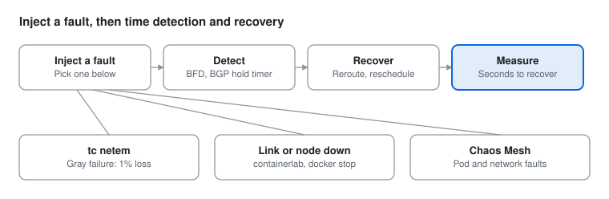

# Lab 10: Failure practice

[All labs](../../README.md) · [Notes](NOTES.md)

Fit: both · 16–18 GB · builds on labs 3 and 9. The point is measuring recovery, not just watching failover happen.

- **Build:** scripts that inject faults (containerlab link down, `docker stop`, `tc netem` for loss and delay), Chaos Mesh in the cluster, and lab 9's dashboards to measure.
- **Learn:** why gray failures are harder to catch than clean ones, BFD vs BGP timers, and what "recovered" means for an application.
- **Automation:** like [Netflix's ChAP](https://blog.acolyer.org/2019/07/05/automating-chaos-experiments-in-production/), which combines fault injection, baseline and canary clusters, traffic steering and telemetry. Here: Chaos Mesh experiments as YAML in git, each comparing a baseline and an experiment group in Prometheus.

1. Shut a leaf link and time BGP convergence with and without BFD.
2. Add 1% loss to one link with `tc netem` and find it from telemetry alone.
3. Kill a worker with Chaos Mesh and time how long the service runs short of backends.
4. Write a short postmortem for each run: what you saw, when, and what would have caught it sooner.

**Verify:** one check per exercise, same numbers; load the helpers first with `source ../../shared/verify.sh lab03` (see [verifying a lab](../../docs/verify.md)).

1. `on client ping -i 0.1 -c 300 $SVC_IP` across the link shut: lost packets times 0.1 s is the outage. `NOTES.md` has the figure with and without BFD, and the BFD figure is smaller.
2. Find the link from the dashboards before looking at the script, then confirm with `sudo containerlab tools netem show -n clab-lab03-leaf1` that the impaired interface is the one you named.
3. `kubectl get podchaos -A` shows the experiment, and `kubectl -n demo get endpointslices -l kubernetes.io/service-name=web -w` shows the dead pods' addresses leave and their replacements arrive. `NOTES.md` has the time between the two.
4. No command. There is one postmortem per run in the lab folder, each with a timeline and what would have caught it sooner.
