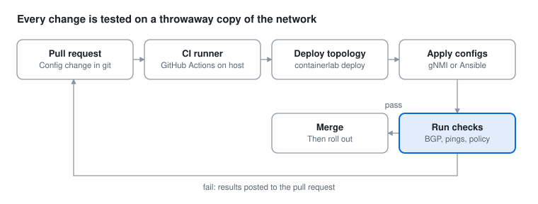

# Lab 11: Network changes tested in CI

[All labs](../../README.md) · [Notes](NOTES.md)

Fit: both · 10–14 GB · uses lab 3's configs. Safe change across a large fleet matters to both kinds of employer, and this shows the habit concretely.

- **Build:** switch configs and the topology file in git, plus a self-hosted GitHub Actions runner on the host that runs `containerlab deploy`, pushes the configs, runs checks and finishes with `containerlab destroy`.
- **Public repo:** never attach the self-hosted runner to this public repo; a pull request from anyone would run `containerlab` as root on the host. Run this lab against a private mirror of the repo.
- **Learn:** treating the network as code, automated testing before a change, and gated rollouts.
- **Automation:** like [ESnet's ROVER](https://ES.net/assets/Uploads/Building-a-Realistic-Orchestration-Validation-Environment-for-netwoRks-ROVER.pdf), a containerlab-based environment for testing orchestration before production. Here: GitHub Actions running containerlab, Batfish, and pytest with Nornir and gnmic checks.

1. Put lab 3's configs in a repo with the runner attached.
2. Write checks: every BGP session up, the service IP reachable from the client, policies enforced.
3. Open a pull request that breaks a BGP peer and confirm the check fails and reports on the PR.
4. Add a rollout step that runs only after merge.

**Extend:** upgrade Cilium by one minor version through the same pipeline, rolling it out node by node while lab 9's dashboards watch for drops.

**Published labs:** Arista Test Drive's automation workshops include [CI/CD Basics](https://labguides.testdrive.arista.com/2026.2/automation/workshops_overview/) with GitHub Actions, and [network test automation](https://github.com/aristanetworks/ci-workshops-avd) with ANTA for checks before and after a change. **Differs:** they run against Arista's hosted lab, one long-lived fabric. This lab builds a throwaway containerlab topology for every pull request and tests it with Batfish, pytest, Nornir and gnmic, as ESnet's ROVER does, so a bad change never touches a shared fabric. On cEOS, ANTA can replace part of the pytest suite.
