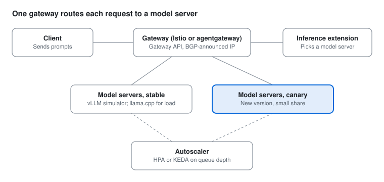

# Lab 12: Inference serving

[All labs](../../README.md) · [Notes](NOTES.md)

Fit: AI · about 12 GB · lab 3's fabric is optional. Serving traffic is a large share of what an AI lab's network carries.

- **Build:** a gateway the Inference Extension's guide supports (Istio or agentgateway; NGINX Gateway Fabric also works), the Gateway API Inference Extension, the vLLM simulator as stable and canary model servers for the routing exercises, a small CPU model server (such as llama.cpp's server) for the load test, HPA or KEDA, and the gateway's IP announced over BGP, with the client behind lab 3's border leaf when you use that fabric.
- **Learn:** north-south traffic management, model-aware routing, canary releases and autoscaling under load.
- **Automation:** like [GKE Inference Gateway](https://docs.cloud.google.com/kubernetes-engine/docs/concepts/about-gke-inference-gateway), built on the open Gateway API Inference Extension and installed with Helm. Here: the gateway and Inference Extension charts via Argo CD, with canary weights in git.

1. Expose the stable model servers through the gateway and reach them from the client.
2. Send a small share of traffic to the canary and shift it with HTTPRoute weights.
3. Load-test and watch the autoscaler add replicas.
4. Kill a model server mid-test and check error rates at the gateway.

**Verify:** one check per exercise, same numbers; load the helpers in [shared/helpers.sh](../../shared/helpers.sh) first with `source ../../shared/helpers.sh lab03` (see [verifying a lab](../../docs/verify.md)). Without lab 3's fabric, run the client commands from any pod in place of `on client`.

1. `kubectl get gateway,httproute,inferencepool -A` shows the Gateway `Programmed` and the route `Accepted`, and `on client curl -s -o /dev/null -w '%{http_code}\n' http://$GW_IP/v1/models` prints `200`.
2. `kubectl get httproute llm -o jsonpath='{.spec.rules[0].backendRefs[*].weight}'` prints the weights in git. Send 200 requests and count them per server with `kubectl logs`: the canary's share is close to its weight, and moves when the weight does.
3. `kubectl get hpa -w` during the load test shows replicas rise above the minimum, then fall after it ends.
4. The load tool's report for the run with a server killed shows the non-2xx count. `NOTES.md` has that count and how long errors lasted.

**Extend:** add ExternalDNS to publish the gateway's name and cert-manager to issue its TLS certificate automatically.

**Published labs:** the Inference Extension's own [getting-started guide](https://gateway-api-inference-extension.sigs.k8s.io/) runs on kind (with an extra step for LoadBalancer services) and offers a vLLM simulator that needs no GPU. **Differs:** the guide's gateway providers are GKE, Istio, agentgateway and NGINX Gateway Fabric, not Envoy Gateway, so the build uses one of those. Its CPU vLLM option wants 9.5 GB and 12 CPUs per replica, so the build uses the simulator for routing and llama.cpp only for the load test. This lab adds a canary, autoscaling and a BGP-announced gateway on lab 3's fabric, because serving traffic has to leave the cluster.
