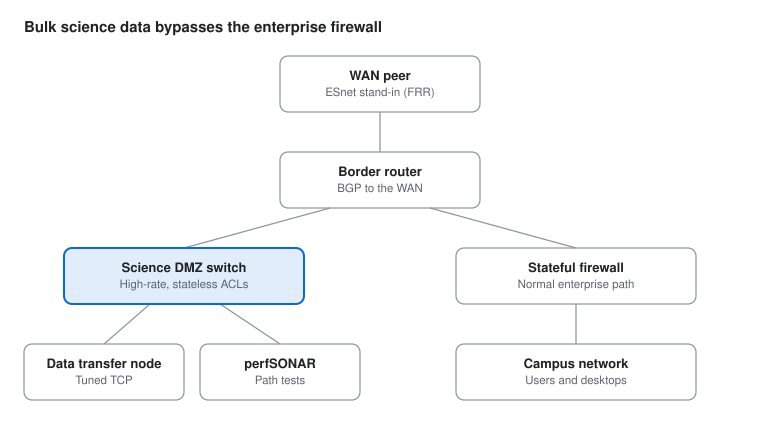

# Lab 13: Science DMZ and data transfer

[All labs](../../README.md) · [Notes](NOTES.md)

Fit: national labs · 10–12 GB. Moving big experiment data fast is central to network work at NERSC and ESnet.

- **Build:** an FRR WAN peer, a border router (cEOS or VyOS), an SR Linux Science DMZ switch with stateless ACLs, a VyOS or nftables firewall in front of a campus network, plus a DTN and a perfSONAR container.
- **DTN as a VM:** run the DTN, and the far-end transfer host, as small libvirt VMs bridged into the topology, not as containers. Containers share the host's kernel, and some of the TCP settings this lab tunes (the `net.core` buffer limits, the congestion-control modules) are host-wide, so a container DTN would change the host and couldn't be tuned independently of its peer.
- **Learn:** Science DMZ design, why stateful firewalls hurt bulk TCP, TCP tuning for long, fast paths, and measuring paths with perfSONAR.
- **Automation:** like [ESnet's fasterdata guidance](https://fasterdata.es.net/science-dmz/science-dmz-performance-monitoring/): a perfSONAR host running continuous latency and loss tests, plus periodic iperf3 tests via pScheduler. Here: pSConfig templates in git and Ansible for DTN tuning.

1. Add 60 ms of delay on the WAN link with `tc netem` to mimic a cross-country path.
2. Move a large file to the DTN with default TCP settings, then with larger buffers and BBR; compare.
3. Send the same transfer through the firewall path and compare throughput.
4. Schedule perfSONAR tests, then add loss to the path and see what they catch.

**Published labs:** the University of South Carolina's [perfSONAR 5 lab library](https://research.cec.sc.edu/files/cyberinfra/files/End-to-end%20monitoring%20with%20perfSONAR%2C%20NETLAB%20platform.pdf) runs perfSONAR in Docker over Mininet topologies, on hosted pods offered at its [Science DMZ workshops](https://research.cec.sc.edu/cyberinfra/dmz-p4-dpdk-workshop) with EPOC. Its labs cover pScheduler, pSConfig templates and Grafana dashboards. **Differs:** Mininet switches are generic; this lab uses real NOS images for the border, the DMZ switch and the firewall, so ACLs and the firewall path behave like production gear. Their pSConfig and Grafana exercises slot into exercise 4.
