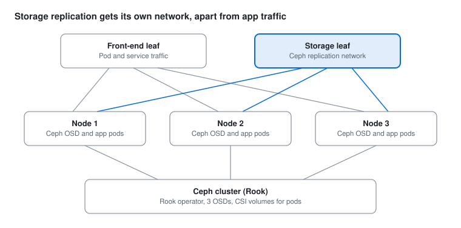

# Lab 13: Storage networking

[All labs](../../README.md) · [Notes](NOTES.md)

Fit: both · 14–18 GB · builds on lab 3. Storage traffic behaves differently from app traffic, and both national labs and AI labs give it its own network.

- **Build:** kind workers with a second interface to a storage leaf, the Rook operator deploying Ceph with its public and cluster networks on separate interfaces, loop devices on the host passed into the nodes as OSD disks, and CSI-backed volumes for test pods.
- **Network separation:** use Rook's host network provider, with the CephCluster's `addressRanges` naming the public and cluster subnets; in kind, "host" is the node container, so Ceph sees both of its interfaces. Multus is the alternative and adds a moving part. Rook's default pod networking puts both networks on the CNI and gives nothing to separate.
- **Memory:** set `osd_memory_target` to about 1.5 GB. At the 4 GB default, three OSDs alone pass the RAM estimate.
- **Learn:** separating replication traffic, how CSI attaches volumes, and how storage behaves when its network degrades or a node fails.
- **Automation:** like HPE Cray System Management at NERSC, which runs [Ceph as utility storage](https://Slurm.schedmd.com/SLUG23/NERSC-SLUG23.pdf) for file, block and object storage. Here: Rook and CephCluster resources via Helm and Argo CD.

1. Deploy Rook-Ceph and confirm with captures that replication uses only the storage network.
2. Create a volume, write to it with `fio`, and record throughput and latency.
3. Fail a storage-leaf link, then a whole node, and watch Ceph rebalance.
4. Throttle the storage network with `tc` and see how a database pod reacts.

**Verify:** one check per exercise, same numbers; load the helpers first with `source ../../shared/verify.sh lab03` (see [verifying a lab](../../docs/verify.md)).

1. `kubectl -n rook-ceph exec deploy/rook-ceph-tools -- ceph status` shows `HEALTH_OK` with three OSDs up, and `ceph osd dump | grep '^osd\.'` in the same pod shows each OSD's cluster address in the storage subnet. During a write, `cap leaf1 -i e1-1 portrange 6800-7300 -c 5` on a front-end link captures no replication traffic between OSDs.
2. `kubectl -n demo get pvc` shows the claim `Bound` to the Ceph storage class. `NOTES.md` has the `fio` throughput and latency.
3. `ceph status` goes from `HEALTH_OK` to degraded and back without help after each failure. `NOTES.md` has the time each recovery took.
4. `docker exec k8s-worker tc qdisc show dev eth3` shows the netem rule on the storage interface. `NOTES.md` has the database's latency before and during the throttle.
