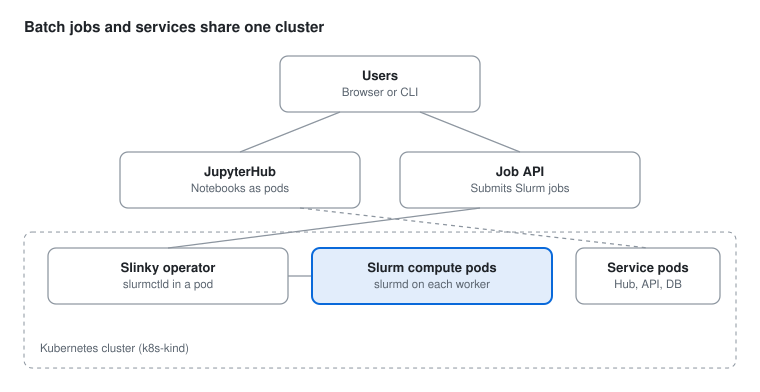

# Lab 15: Slurm and Kubernetes side by side

[All labs](../../README.md) · [Notes](NOTES.md)

Fit: national labs · 10–12 GB · kind is enough; containerlab is optional. This mirrors NERSC's split between Slurm-scheduled compute and Spin-hosted services.

- **Build:** a kind cluster with Cilium, Slinky (SchedMD's Slurm operator for Kubernetes), JupyterHub and a small job-submission API.
- **Learn:** how batch scheduling and service platforms coexist, how Slurm jobs and pods share nodes, and putting user-facing services in front of a scheduler.
- **Automation:** like [NERSC Spin](https://docs.nersc.gov/services/spin/faq/): Rancher-based Kubernetes, apps deployed with Helm, and jobs submitted through the Superfacility API. Here: Slinky and JupyterHub Helm charts and a small REST job API.

1. Install Slinky and run `srun hostname` across the compute pods.
2. Deploy JupyterHub and submit a job from a notebook through the job API.
3. Separate the Slurm pods and the service pods with network policies.
4. Scale the compute pods up and watch Slurm pick up the new nodes.

**Verify:** one check per exercise, same numbers (see [verifying a lab](../../docs/verify.md)). Set `CTL` to the Slurm controller pod's name from `kubectl -n slurm get pods`.

1. `kubectl -n slurm exec $CTL -- sinfo` shows the compute nodes `idle`, and `kubectl -n slurm exec $CTL -- srun -N 2 hostname` prints two different node names.
2. After the notebook submits its job, `kubectl -n slurm exec $CTL -- sacct -X --format=JobID,JobName,State` lists it as `COMPLETED`.
3. A pod in the JupyterHub namespace can reach the job API but not a compute pod: `curl -s -m 3` to the API returns a response, and to a `slurmd` pod's address it times out.
4. `kubectl -n slurm exec $CTL -- sinfo -N` lists the added nodes within a minute or two of scaling up, and a job sized for the new total runs.

**Published labs:** Slinky's [slurm-operator](https://github.com/SlinkyProject/slurm-operator) quickstart installs the operator and a Slurm cluster from Helm charts, and its repo has a kind script for a local test cluster. Follow the docs for the current release and pin that chart version in git; the charts and their values changed between the 0.x releases and 1.0. Google publishes the same on [GKE](https://docs.cloud.google.com/kubernetes-engine/docs/add-on/slurm-on-gke/quickstarts/deploy-slurm-on-gke). **Differs:** they stop at a running Slurm cluster. This lab adds JupyterHub, a job API and network policies between Slurm and service pods, to mirror NERSC's split between Slurm compute and Spin services.
