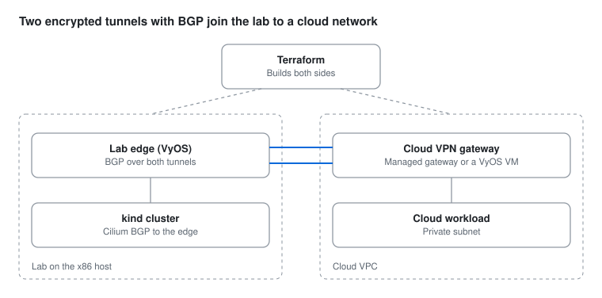

# Lab 16: Hybrid cloud connectivity

[All labs](../../README.md) · [Notes](NOTES.md)

Fit: AI · 4–6 GB locally plus a small cloud account. Anthropic's postings ask for cloud networking: VPC design and peering, Interconnect and Direct Connect, cross-cloud private connectivity, and BGP route control ([posting](https://jobs.accel.com/companies/anthropic/jobs/77047629-staff-infrastructure-engineer-cluster-infrastructure)).

- **Build:** Terraform creating a cloud VPC, a private subnet with a test workload, and either the provider's managed VPN gateway or a small VyOS VM; a VyOS edge in containerlab; two IPsec or WireGuard tunnels running BGP; and a kind cluster announcing a service prefix to the edge with Cilium.
- **Learn:** the cloud's routing model, BGP over tunnels, route filtering, failover between tunnels, and MTU problems on encrypted paths.
- **Cost:** managed VPN gateways bill by the hour, so destroy them after each session; a VyOS VM on a free-tier instance is the cheaper option.
- **Automation:** Anthropic's postings name Terraform and Atlantis for infrastructure as code. Here: Terraform for both sides, planned on each pull request and applied after review.

1. `terraform apply` both sides, bring up the tunnels and check BGP.
2. Advertise only the service prefix in each direction and filter everything else.
3. Drop one tunnel and time failover; make one tunnel preferred with local preference or AS-path prepending.
4. Find the tunnel MTU, fix TCP MSS clamping, and confirm large transfers work.
5. `terraform destroy` at the end of each session.

**Verify:** one check per exercise, same numbers; load the helpers first with `source ../../shared/verify.sh lab16` (see [verifying a lab](../../docs/verify.md)). The `edge` node is VyOS, which answers `frr` commands.

1. `terraform output` prints the tunnel endpoints, and `frr edge "show bgp summary"` shows both tunnel sessions `Established`.
2. `frr edge "show bgp ipv4 unicast neighbors $PEER1 advertised-routes"` lists only the service prefix, and the `received-routes` form (or `routes`) lists only the VPC prefix.
3. `frr edge "show bgp ipv4 unicast $VPC_PREFIX"` marks the preferred tunnel's path as best. `on client ping -i 0.2 -c 300 $CLOUD_VM_IP` across a tunnel drop gives the failover time, recorded in `NOTES.md`.
4. `on client ping -M do -s $SIZE -c 2 $CLOUD_VM_IP` succeeds at the tunnel MTU minus 28 and fails one byte higher. A 100 MB `curl` download through the tunnel completes.
5. `terraform state list | wc -l` prints `0`, and the provider's console shows no gateway or instance left.
