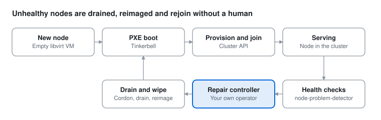

# Lab 17: Bare-metal node lifecycle

[All labs](../../README.md) · [Notes](NOTES.md)

Fit: both · 16–20 GB · uses libvirt VMs as "bare-metal" nodes. Anthropic's Node Infra team owns node ingestion, bring-up, health checking and automated repair ([posting](https://job-boards.greenhouse.io/anthropic/jobs/5203868008)), and HPC centers run the same lifecycle with their own system management tools.

- **Build:** Tinkerbell's CAPT playground as the base (a kind management cluster, Tinkerbell, Cluster API with the Tinkerbell provider, libvirt VMs that PXE-boot from it, and a virtual BMC), node-problem-detector, and a small repair controller you write yourself (Python with kopf, or Go with controller-runtime) that cordons, drains and reprovisions nodes that stay unhealthy.
- **Learn:** provisioning pipelines, declarative cluster lifecycle, rolling Kubernetes upgrades, and writing a Kubernetes controller, which is the core skill behind automated fleet operations.
- **Automation:** the Node Infra posting describes this lifecycle at fleet scale, and HPC centers run it with tools like HPE Cray System Management. Here: Tinkerbell templates and Cluster API manifests in git, plus the repair controller you write.

1. PXE-boot three VMs and join them into a cluster with Cluster API.
2. Upgrade Kubernetes by changing the version in git and watch Cluster API replace nodes one at a time.
3. Break a node (fill its disk or stop the kubelet) and let your controller drain and reimage it.
4. Add safety limits so the controller never repairs more than one node at a time or more than a set number per hour.

**Verify:** one check per exercise, same numbers (see [verifying a lab](../../docs/verify.md)). `mgmt` is the management cluster's context, and `workload.kubeconfig` the provisioned cluster's.

1. `kubectl --context mgmt get machines -A` shows three machines `Running`, and `kubectl --kubeconfig workload.kubeconfig get nodes` shows three nodes `Ready`.
2. `kubectl --kubeconfig workload.kubeconfig get nodes -o custom-columns='NAME:.metadata.name,VERSION:.status.nodeInfo.kubeletVersion'` shows the new version on every node, and `kubectl --context mgmt get machines -A -w` during the upgrade showed at most one machine being replaced at a time.
3. After you break a node, `kubectl --kubeconfig workload.kubeconfig get nodes -w` shows it cordoned, removed, and replaced by a `Ready` node with no action from you, and the controller's log names each step.
4. With two nodes broken at once, `kubectl --context mgmt get machines -A` shows only one being replaced, and the controller's log says the second was deferred by the limit.

**Published labs:** Tinkerbell's [CAPT playground](https://github.com/tinkerbell/playground/blob/main/capt/README.md) is most of this lab's build. One command creates a kind management cluster, the Tinkerbell stack, Cluster API with the Tinkerbell provider, libvirt VMs for the workload cluster and a virtual BMC; it needs libvirt, 8 GB free RAM, 4 cores and 60 GB of fast disk. **Differs:** the playground covers create and delete; its upgrade and scale steps are still marked to be written. This lab adds those, plus node-problem-detector and a repair controller you write, because the repair loop is the skill Anthropic's Node Infra posting describes. The build starts from the playground rather than wiring Tinkerbell by hand.
