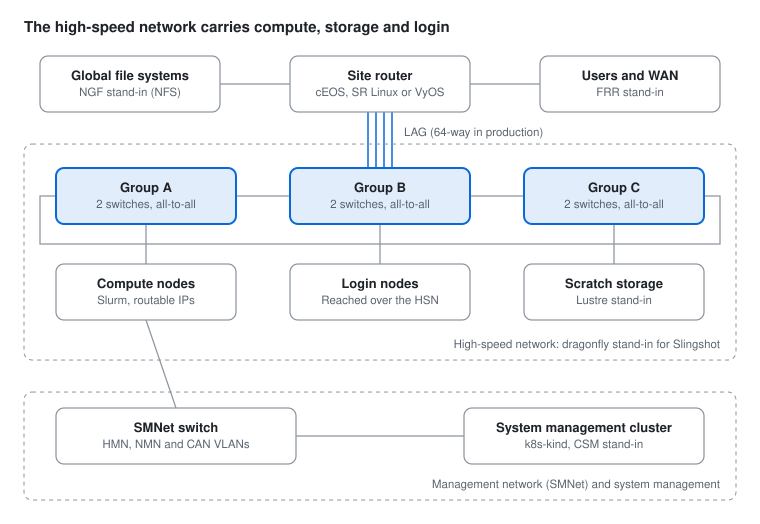

# Lab 17: Perlmutter-style network

[All labs](../../README.md) · [Notes](NOTES.md)

Fit: national labs · 20–25 GB.

This lab follows NERSC's published network design for Perlmutter, its current flagship: a Slingshot high-speed network (HSN) in a 2-level dragonfly that carries compute, storage and login traffic; a LAG from the HSN to the site network; and a separate management network with Kubernetes running system management ([CUG 2022 paper](https://cug.org/proceedings/cug2022_proceedings/includes/files/pap117s2-file1.pdf), [SLUG23 talk](https://Slurm.schedmd.com/SLUG23/NERSC-SLUG23.pdf)). Slingshot itself can't be emulated, so the HSN is an Ethernet dragonfly stand-in.

The dragonfly groups (accent) form the HSN; the LAG (accent lines) joins it to the site network.

- **High-speed network:** switches in groups, all-to-all inside each group, and one global link between every pair of groups. Compute nodes, login nodes and scratch storage all attach here, and every node has a routable IP.
- **Site edge:** the HSN connects to the site network through a LAG (64-way in production), so nodes reach the global file systems and users directly.
- **Management:** a separate network, logically split into hardware management (HMN), node management (NMN) and the customer access network (CAN) that admins use to reach API gateways. System services run on a Kubernetes cluster here.
- **Not modeled:** Slingshot's adaptive, non-minimal routing and congestion control, which are switch hardware features.
- **Build:** the nodes in the table below.
- **Learn:** dragonfly topology and routing, LAG design, routable compute nodes, and splitting management traffic into its own networks.
- **Automation:** like [HPE Cray System Management](https://cray-hpe.github.io/docs-csm/en-17/operations/configuration_management/configuration_management), where CFS runs Ansible from inside Kubernetes, with playbooks in a Gitea VCS and configurations layered and pinned to git commits. Here: Ansible playbooks in a local Gitea, run by Kubernetes Jobs as ordered layers.

| Role | Containerlab kind / image | Count | RAM each (approx.) |
| --- | --- | --- | --- |
| HSN dragonfly switches (3 groups of 2) | `nokia_srlinux` or `arista_ceos` | 6 | 1.5–2 GB |
| Site router | `arista_ceos`, `nokia_srlinux`, or `linux` / VyOS | 1 | 1–2 GB |
| SMNet switch | `nokia_srlinux` or `arista_ceos`, with HMN/NMN/CAN VLANs | 1 | 1.5–2 GB |
| Compute nodes | `linux` / Slurm containers (slurmctld + slurmd) | 4 | 0.5 GB |
| Login nodes | `linux` | 2 | 0.3 GB |
| Scratch storage (Lustre stand-in) | `linux` / NFS-Ganesha or MinIO | 1 | 0.5 GB |
| Global file systems (NGF stand-in) | `linux` / NFS-Ganesha | 1 | 0.5 GB |
| Users and WAN | `linux` / FRR | 1 | 0.2 GB |
| System management cluster | `k8s-kind`: 1 control plane + 2 workers as `ext-container` nodes, on the NMN | 3 | 1.5–2 GB |

The NFS stand-ins use NFS-Ganesha, a userspace server. The kernel NFS server in a container runs in the host's kernel (`nfsd`), needs a privileged container, and changes the host.

1. Wire the dragonfly: both switches in a group linked, one global link per group pair. Run eBGP or OSPF and check that traffic takes the direct global link between groups.
2. Bundle 4 links between an HSN switch and the site router with LACP as the LAG; fail members one at a time and watch throughput and hashing.
3. Give compute and login nodes routable IPs; confirm they reach the global file systems and the WAN without NAT.
4. Put HMN, NMN and CAN in separate VLANs or VRFs on the SMNet switch; run DNS and monitoring in the kind cluster on the NMN and expose an API gateway only on the CAN.
5. Run a small Slurm job across the compute nodes, with iperf3 between them as stand-in MPI traffic, then fail a global link and watch it reroute through the third group.
