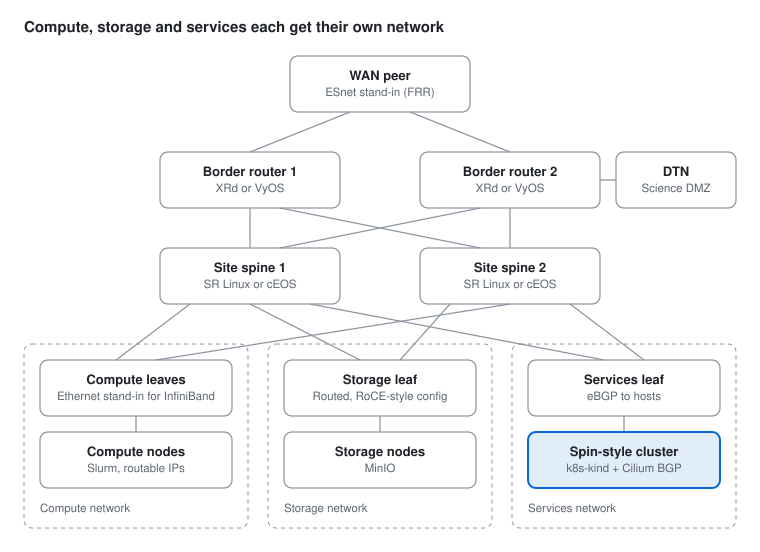

# Lab 19: Doudna-style network

[All labs](../../README.md) · [Notes](NOTES.md)

Fit: national labs · 22–26 GB.

This lab reproduces the network pattern NERSC publishes for Perlmutter, which Doudna is expected to extend: separate compute, storage and service networks, every node routable, and a WAN edge to ESnet for streaming data from experiments. Doudna's compute network is reported to be NVIDIA Quantum-X800 InfiniBand ([DCD](https://www.datacenterdynamics.com/en/news/does-lbnl-selects-dell-nvidia-system-for-nersc-10-doudna-supercomputer/)); InfiniBand can't be emulated, so the compute fabric here is an Ethernet stand-in.

- **Compute network:** a leaf pair carrying Slurm compute nodes with routable IPs. The real system uses a dedicated low-latency fabric; the lab only reproduces its routing and edge integration.
- **Storage network:** routed Ethernet to storage nodes, matching NERSC's move from InfiniBand to RoCE for its global file systems. PFC and ECN can be configured on the leaf, but lossless behavior can't be tested in software.
- **Services network:** a Spin-style Kubernetes cluster for gateways, APIs and databases, announcing its ingress and LoadBalancer IPs into the site fabric with Cilium BGP.
- **Site edge:** two border routers peering with a WAN stand-in for ESnet, and a data transfer node (DTN) in a Science DMZ for high-rate external transfers.
- **Build:** the nodes in the table below. It needs about 22–26 GB as listed; XRd borders add about 4 GB over VyOS, and vJunos or Nexus borders add roughly 8–18 GB.
- **Learn:** separating compute, storage and service networks, routable nodes, a WAN edge with a data transfer node, and keeping storage traffic isolated.
- **Automation:** Doudna's management stack isn't public yet, so this follows NERSC practice: lab 17's Ansible layers plus lab 8's monitoring.

| Role | Containerlab kind / image | Count | RAM each (approx.) |
| --- | --- | --- | --- |
| WAN peer (ESnet stand-in) | `linux` / FRR | 1 | 0.2 GB |
| Border routers | `cisco_xrd` (XRd control plane), or `linux` / VyOS to save RAM | 2 | 3 GB (XRd) / 1 GB (VyOS) |
| Site spines | `nokia_srlinux` or `arista_ceos` | 2 | 1.5–2 GB |
| Compute, storage, services leaves | `nokia_srlinux` or `arista_ceos` | 4 | 1.5–2 GB |
| Compute nodes | `linux` / Slurm containers (slurmctld + slurmd), FRR for host routes | 4 | 0.5 GB |
| Storage nodes | `linux` / MinIO | 2 | 0.5 GB |
| DTN | `linux` / iperf3 and a transfer tool | 1 | 0.3 GB |
| Spin-style cluster | `k8s-kind`, 1 control plane + 2 workers as `ext-container` nodes, Cilium (kind's default CNI disabled) | 3 | 2 GB |

1. Bring up the site fabric (eBGP between spines and leaves) and the border routers with default routes from the WAN peer.
2. Give compute nodes routable /32s and advertise them; check they reach storage and services directly.
3. Put storage in its own VRF on the fabric and confirm compute-to-storage traffic never crosses the services network.
4. Deploy an ingress and a sample science gateway in the kind cluster; announce its IP with Cilium BGP and reach it from the WAN peer.
5. Push data from the WAN into the DTN and storage, then fail a border router and watch the path move.
