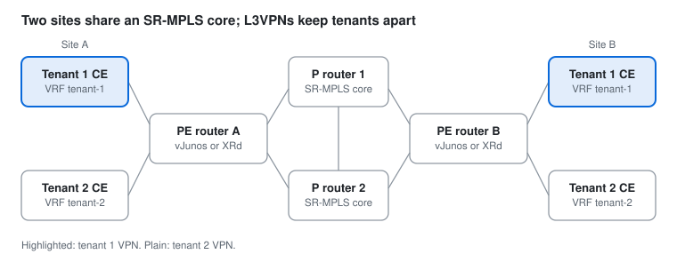

# Lab 19: Multi-site WAN

[All labs](../../README.md) · [Notes](NOTES.md)

Fit: national labs · 16–24 GB · needs x86 VM images. Research networks join sites with service-provider-style cores, and this lab uses the vendor images an x86 host can run.

- **Build:** two PE routers on vJunos-router or XRd, two P routers on SR Linux or XRd, IS-IS with SR-MPLS (or SRv6), BGP VPNv4 between the PEs, and four FRR CE containers for two tenants at two sites.
- **Check first:** confirm each image supports what its role needs before building around it. SR Linux's SR-MPLS support depends on the emulated chassis type, and some chassis types need a licence file in containerlab; if the P routers can't forward SR-MPLS as pulled, use XRd, cRPD or FRR there. For exercise 4, check SRv6 support the same way; XRd and FRR are the likely choices for an SRv6 core.
- **Learn:** segment routing, L3VPN tenant separation, fast reroute and traffic engineering across a WAN core.
- **Automation:** like [ESnet6](https://www.es.net/about/esnet-staff/network-engineering-and-operations/chris-cummings/), where the Workflow Orchestrator and Cisco NSO turn service intent into router config. Here: NetBox as the intent store, with Workflow Orchestrator workflows (or Nornir) pushing L3VPN configs.

1. Bring up IS-IS with segment routing and check the label stack in the core.
2. Configure L3VPNs for both tenants and prove tenant 1 can't reach tenant 2.
3. Fail P router 1 and time the switch to P router 2, with and without TI-LFA.
4. Rebuild the core with SRv6 instead of SR-MPLS and compare.

**Verify:** one check per exercise, same numbers; load the helpers first with `source ../../shared/verify.sh lab19` (see [verifying a lab](../../docs/verify.md)). The P and PE commands are for XRd; on vJunos, connect with `ssh` and use the Junos equivalents.

1. `xr p1 "show isis segment-routing label table"` lists a prefix SID for each router, and `xr p1 "show mpls forwarding"` shows a label entry for each PE loopback.
2. `frr ce-a1 "show ip route bgp"` has tenant A's remote prefix and none of tenant B's, `on ce-a1 ping -c 3 $CE_A2_IP` succeeds, and `on ce-a1 ping -c 3 $CE_B2_IP` fails.
3. `on ce-a1 ping -i 0.01 -c 3000 $CE_A2_IP` across the failure: lost packets times 10 ms is the outage. `NOTES.md` has it with and without TI-LFA, and the TI-LFA figure is smaller.
4. Check 2 passes again on the SRv6 core, and `cap p1 -i Gi0-0-0-0 ip6 -c 5` on a core link shows tenant traffic carried in IPv6.

**Published labs:** ipSpace's [SR-workshop](https://github.com/ipspace/SR-workshop) has netlab and containerlab topologies for a segment-routing workshop, and [netlab: L3VPN with an SR-MPLS core](https://blog.ipspace.net/2026/03/netlab-sr-mpls-l3vpn/) builds the VPN layer. Nokia's [nokia-segment-routing-lab](https://github.com/srl-labs/nokia-segment-routing-lab) shows Flex-Algo, and [clab-crpd-segment-routing](https://github.com/dbono711/clab-crpd-segment-routing) builds an SR-MPLS L3VPN with Juniper cRPD and CE containers. **Differs:** these teach the protocols. This lab adds two tenants at two sites and an intent store (NetBox with Workflow Orchestrator or Nornir) that generates the VPN configs, as ESnet6 does. cRPD runs as a container, not a VM, so it can replace the vJunos PEs to save RAM.
