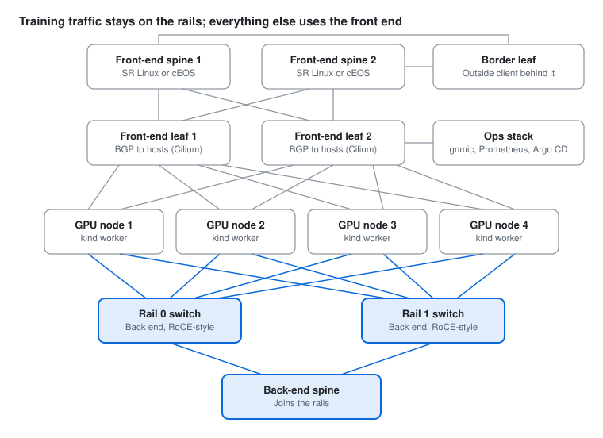

# Lab 21: GPU training cluster, two fabrics

[All labs](../../README.md) · [Notes](NOTES.md)

Fit: AI · 24–26 GB.

This lab copies the two-fabric layout of a GPU training cluster: a routed front end for storage, serving and management, and a separate rail-optimized back end for GPU-to-GPU traffic. There are no GPUs or RDMA NICs, so it practices the architecture and operations, not training performance.

- **Front end:** leaf-spine with BGP to the hosts. Cilium on each node announces pod CIDRs and service IPs, as in lab 3, and outside traffic enters through a border leaf.
- **Back end:** each "GPU node" has one NIC per rail. NIC 0 on every node goes to Rail 0, NIC 1 to Rail 1, and a back-end spine joins the rails. Pods get those NICs as second and third interfaces through Multus.
- **Ops stack:** gnmic streams switch telemetry into Prometheus and Grafana; Argo CD keeps cluster config in git; switch configs are pushed from git over gNMI.
- **Build:** the nodes in the table below.
- **Learn:** front-end and back-end fabric design, rail layout, secondary pod interfaces with Multus, and running both fabrics from git.
- **Automation:** like [NVIDIA DGX SuperPOD](https://docs.nvidia.com/dgx-superpod/release-notes/latest/10-25-03.html): Base Command Manager provisioning, Kubernetes with the GPU and Network Operators, MetalLB, MPI Operator and kube-prometheus-stack, and UFM for InfiniBand. Here: Multus, whereabouts and rail attachments by Helm, laid out like the Network Operator's policies, with Argo CD for the rest.

| Role | Containerlab kind / image | Count | RAM each (approx.) |
| --- | --- | --- | --- |
| Front-end spines and leaves | `nokia_srlinux` or `arista_ceos` | 4 | 1.5–2 GB |
| Rail switches and back-end spine | `nokia_srlinux` or `arista_ceos` | 3 | 1.5–2 GB |
| Cluster | `k8s-kind`: 1 control plane + 4 workers as `ext-container` nodes; eth1/eth2 to front-end leaves, eth3/eth4 to rails | 5 | 1.5 GB |
| CNI and attachments | Cilium (kind default CNI disabled, `cni.exclusive=false` so Cilium leaves Multus's CNI config in place), Multus, whereabouts IPAM, macvlan NetworkAttachmentDefinitions on eth3/eth4 | – | in cluster |
| Ops | kube-prometheus-stack, gnmic, Argo CD in the cluster | – | about 3 GB |
| Border leaf and outside client | `nokia_srlinux` or `arista_ceos`, plus `linux` / FRR | 1 + 1 | 1.5–2 GB + 0.2 GB |

1. Build both fabrics: eBGP on the front end; on the back end, give each rail its own subnet and route between rails through the back-end spine.
2. Install Multus and attach test pods to both rails; run all-to-all iperf3 between pods to stand in for collective traffic.
3. Configure PFC and ECN on the rail switches through gNMI from git, and alert in Grafana on interface errors and drops. The virtual switches accept the config without enforcing it; [lab 22](../22-lossless-roce/README.md) covers what these settings do and how to choose them.
4. Fail a rail switch or one node's rail link and confirm traffic stays on the surviving rail while the front end is untouched.
5. Cordon and drain a node, watch its BGP routes withdraw, then roll a switch config change through git and check for drift.

**Published labs:** [NVIDIA Air](https://www.nvidia.com/en-us/networking/network-simulation), now DSX Air, builds free cloud digital twins of AI fabrics: Spectrum-X switches on Cumulus Linux or SONiC, BlueField DPUs and x86 servers ([Spectro Cloud walkthrough](https://www.spectrocloud.com/blog/how-to-simulate-multi-tenant-ai-infrastructure)). NVIDIA's [Spectrum-X administration course](https://academy.nvidia.com/en/course/spectrumx-public-training/?cm=92500) runs its RoCE, congestion-control and NetQ exercises there. **Differs:** Air models NVIDIA's own stack, with its real configs. This lab is vendor-neutral and adds the Kubernetes side, Multus rail attachments and a GitOps ops stack, which Air doesn't teach. Use Air to see a real Spectrum-X configuration, and this lab for how the cluster consumes the fabric.
