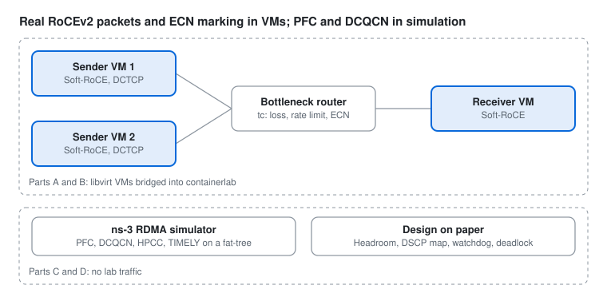

# Lab 22: Lossless Ethernet and RoCE congestion control

[All labs](../../README.md) · [Notes](NOTES.md)

Fit: AI, useful for both · about 6 GB · reads better after labs 5 and 21, but stands alone. Lab 21 builds the back-end fabric's layout and configures PFC and ECN without showing what they do. This lab covers why RDMA needs a lossless network and how congestion is managed on one.

No software switch honors PFC, and DCQCN lives in NIC hardware, so the lab is split by what each tool can show honestly: real RoCEv2 packets from Soft-RoCE, real ECN marking and reaction with DCTCP, and PFC and DCQCN in a packet-level simulator.

- **Build:** three small libvirt VMs (two senders, one receiver) with Soft-RoCE (`rdma_rxe`) and the `perftest` tools, bridged into a containerlab topology with one FRR `linux` node between them as the bottleneck. Separately, the [HPCC ns-3 simulator](https://github.com/alibaba-edu/High-Precision-Congestion-Control) in a container; it builds on an old ns-3 and compiler, so pin the image.
- **VMs, not containers:** `rdma_rxe` and the congestion-control modules are kernel-wide, as in lab 14. Use a distribution that still ships `rdma_rxe`; on Ubuntu it is in `linux-modules-extra`.
- **Learn:** the RoCEv2 packet format and why its flows have little entropy, go-back-N and what loss does to RDMA, PFC (pause, headroom, head-of-line blocking, storms, deadlock, watchdogs), ECN marking thresholds, DCQCN's three roles (switch marks, receiver sends CNPs, sender cuts rate), how DSCP maps traffic to the lossless class, and what InfiniBand's credits and Ultra Ethernet do differently.
- **Automation:** like NVIDIA's [RoCE configuration on Cumulus Linux](https://docs.nvidia.com/networking-ethernet-software/cumulus-linux/Layer-1-and-Switch-Ports/Quality-of-Service/RDMA-over-Converged-Ethernet-RoCE/), where one command expands into the whole lossless profile so no switch is tuned by hand. Here: VM tuning and `tc` settings by Ansible, and simulation configs and plotting scripts in git, so every graph can be rebuilt from a commit.

**Part A: real RoCEv2 packets**

1. Add a Soft-RoCE device to each VM with `rdma link add`, run `rping` and `ib_send_bw`, and capture on the router. Find UDP port 4791, the opcode, the queue pair and the packet sequence numbers. Note which fields a switch could hash on.
2. Add 0.1% and then 1% loss on the router with `tc netem`. Compare `ib_write_bw` throughput with iperf3 over TCP at the same loss, and find the NAKs and the go-back-N retransmissions in the capture. This is the case for a lossless class.
3. Give the router two equal-cost paths to the receiver and open 2, then 16, queue pairs. Record how they spread and relate it to lab 5's exercise 6.

**Part B: ECN marking and reaction**

4. Rate-limit the router's egress so a queue forms, and put RED with ECN marking under it with the minimum and maximum set to one threshold K. Run DCTCP from both senders and watch queue depth and CE marks with `tc -s`.
5. Move K down and up. Record throughput, queue depth and latency for each value, and compare with CUBIC on a drop-tail queue. The switch side of DCQCN is this same marking; [RFC 8257](https://www.rfc-editor.org/rfc/rfc8257) describes the sender side DCQCN borrowed from.

**Part C: PFC and DCQCN in simulation**

6. Run the simulator's fat-tree with DCQCN and an incast of many senders to one receiver. Plot queue depth, pause frames and flow completion times.
7. Turn PFC off and rerun; then turn PFC on and DCQCN off. Explain each result from part A's loss measurements.
8. Add a victim flow that shares an upstream port with the incast but goes to an idle receiver, and measure how PFC slows it. Then change the ECN thresholds until pauses become rare, and record what it costs in throughput.
9. Rerun exercise 6 with HPCC, TIMELY and DCTCP, which the simulator also implements, and compare tail flow completion times.

**Part D: design on paper**

10. Work out PFC headroom for one port and priority: the bytes still arriving after a pause is sent. Do it for a 3 m DAC and a 100 m optic at 400 Gbit/s, and compare with a vendor's default.
11. Draw the cyclic buffer dependency that causes PFC deadlock, from [Guo et al.](https://www.microsoft.com/en-us/research/wp-content/uploads/2016/11/rdma_sigcomm2016.pdf). Explain why up-down routing on a Clos avoids it, which failures bring it back, and what a PFC watchdog does about a storm.
12. Write the lossless profile for lab 21's rail switches as a short spec: which DSCP is RoCE and which is CNP, which priority is lossless, the ECN thresholds, the headroom and the watchdog. Compare it with what `nv set qos roce` generates in NVIDIA Air.
13. Read [Meta's account of RoCE for AI training](https://engineering.fb.com/2024/08/05/data-center-engineering/roce-network-distributed-ai-training-at-scale/) and note what they decided about DCQCN, about hashing low-entropy flows, and why. Then list what [Ultra Ethernet](https://ultraethernet.org/) changes: packet spraying, loss recovery, and whether PFC is still required.

**Verify:** one check per exercise, same numbers; load the helpers first with `source ../../shared/verify.sh lab22` (see [verifying a lab](../../docs/verify.md)). `sender1`, `sender2` and `recv` are the VMs; reach them with `ssh`. Part C and D checks are files in the lab folder.

1. `ssh sender1 rdma link show` shows `rxe0` with state `ACTIVE`, `ssh sender1 ib_send_bw -d rxe0 $RECV_IP` prints a bandwidth while `ssh recv ib_send_bw -d rxe0` listens, and `cap router -i eth1 udp port 4791 -c 5` shows the packets.
2. `on router tc qdisc show dev eth3` shows the netem loss in force. `NOTES.md` has RDMA and TCP throughput at 0%, 0.1% and 1% loss, and the capture shows a NAK followed by resent sequence numbers.
3. `on router ip route show $RECV_NET` lists two next hops, and `on router ip -s link show eth3` and `eth4` give bytes per path. `NOTES.md` has the split for 2 and for 16 queue pairs.
4. `ssh sender1 sysctl net.ipv4.tcp_congestion_control` prints `dctcp`, `on router tc -s qdisc show dev eth3` shows RED with `ecn` and a rising `marked` count, and `ssh sender1 nstat -az TcpExtTCPDeliveredCE` rises during a transfer.
5. No command. `NOTES.md` has throughput, queue depth and latency for at least three values of K and for CUBIC on a drop-tail queue.
6. The run's output and the three plots are in `sim/results/`. The run shows pause frames and no drops.
7. `sim/results/` has both extra runs. Without PFC there are drops and long flow completion times; without DCQCN there are far more pauses.
8. The victim flow's completion time is in `NOTES.md` with and without the incast, with the ECN thresholds that made pauses rare and their throughput cost.
9. `sim/results/` has one run per algorithm, and `NOTES.md` compares their 99th-percentile flow completion times.
10. No command. `NOTES.md` has the headroom in bytes for both cables with the working shown.
11. No command. The lab folder has the drawing and a paragraph on each of the three questions.
12. The profile is a file in the lab folder, and `NOTES.md` lists each difference from what `nv set qos roce` produced.
13. No command. `NOTES.md` has Meta's three decisions with their reasons, and the list of Ultra Ethernet's changes.

It shows mechanisms, not hardware behavior: Soft-RoCE implements the transport but none of a NIC's congestion control, and the simulator's numbers are not those of any real switch.

**Published labs:** NVIDIA's Spectrum-X course on Air (see lab 21) runs RoCE and congestion-control exercises on real Cumulus configs. The [HPCC simulator](https://github.com/alibaba-edu/High-Precision-Congestion-Control), which extends Microsoft's [ns3-rdma](https://github.com/bobzhuyb/ns3-rdma), is the code behind the HPCC paper's results. **Differs:** Air teaches one vendor's configuration without showing the queues, and the simulator ships as research code with no exercises. This lab puts packets, marking, simulation and design in one sequence, so each setting in a vendor's profile has a measurement behind it. Read the [DCQCN paper](https://conferences.sigcomm.org/sigcomm/2015/pdf/papers/p523.pdf) before part C.
