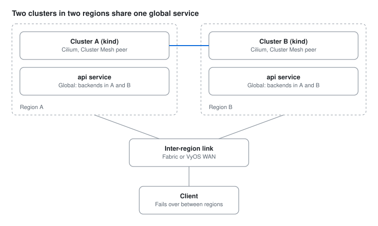

# Lab 23: Multi-cluster and multi-region

[All labs](../../README.md) · [Notes](NOTES.md)

Fit: AI · 16–20 GB · builds on labs 3 and 6. Large operators split work across many clusters and regions; this lab shows the networking that ties them together.

- **Build:** two kind clusters (1 control plane + 2 workers each) on lab 3's fabric or joined by a VyOS "WAN", Cilium Cluster Mesh, a global service with backends in both, and a client outside.
- **Learn:** planning cluster identities and pod CIDRs, global services, failover between regions, and the cost of cross-region latency.
- **Automation:** like [Wildlife Studios](https://cilium.io/blog/2020/09/03/wildlife-studios-multi-cluster-gaming-platform), whose in-house tool built on Kops, Terraform, Helm and Cilium creates Cluster Meshes. Here: Terraform with kind and Helm providers creating both clusters and the mesh.

1. Give the clusters non-overlapping pod CIDRs and join them with `cilium clustermesh connect`.
2. Mark the api service global and watch requests reach both clusters.
3. Prefer local backends, then confirm traffic stays in its region until those fail.
4. Add delay between regions with `tc netem` and measure the effect on cross-region calls.
5. Apply a Cilium network policy that lets only cluster 1's frontend call the global api service, and confirm cluster 2's pods are blocked in both clusters.

**Published labs:** Isovalent's free [Cilium Cluster Mesh](https://isovalent.com/labs/cilium-cluster-mesh) lab is nearly this lab: kind clusters, meshing, global services, opting a service out, service affinity and network policy across clusters, with an exam and a [badge](https://www.credly.com/org/isovalent/badge/cilium-cluster-mesh). **Differs:** this lab adds the network between the clusters, either lab 3's fabric or a VyOS WAN with `tc netem` delay, so failover and cross-region latency can be measured, and builds both clusters with Terraform. Do their lab first; exercise 5 here repeats its cross-cluster policy step over a real WAN.
