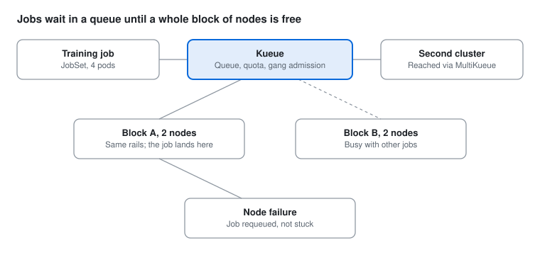

# Lab 24: Anthropic-style scheduling and fleet operations

[All labs](../../README.md) · [Notes](NOTES.md)

Fit: AI · 16–20 GB · builds on labs 21 and 23.

Public reporting shows Anthropic runs mostly on cloud accelerators (AWS Trainium, Google TPUs, NVIDIA GPUs) rather than switch fabrics it configures itself; its first custom data centers, built with Fluidstack, come online through 2026 ([Unite.AI](https://www.unite.ai/anthropic-to-invest-50-billion-in-u-s-data-center-expansion)). On Google Cloud it uses very large GKE clusters, including an architecture co-designed with Google that manages over a million accelerator chips as one pool ([Google Cloud Next session](https://www.googlecloudevents.com/next-vegas/session/3912915/gke-hypercluster-powering-secure-planetary-scale-for-ai-workloads), [SiliconANGLE](https://siliconangle.com/?p=677422)). A second session covers how it handles hardware failures and fragmentation with "modular compute cubes" ([session](https://www.googlecloudevents.com/next-vegas/session/3912931)). So this lab keeps lab 21's topology and moves the practice from switch configs to the Kubernetes layer.

- **Build:** lab 21's topology with Kueue for queues and quotas, JobSet for multi-pod training jobs, nodes labeled by block and rail, Kueue's Topology Aware Scheduling with a Topology object built from those labels, priority classes, and a second kind cluster joined with Cilium Cluster Mesh and MultiKueue.
- **Learn:** gang scheduling, topology-aware placement, recovering jobs from node failures, fragmentation and preemption, and dispatching work across clusters.
- **Automation:** Anthropic's [cluster infrastructure postings](https://jobs.accel.com/companies/anthropic/jobs/77047629-senior-staff-infrastructure-engineer-cluster-infrastructure) name Terraform with Atlantis, and Temporal or Argo Workflows. Here: Terraform with plan-on-PR, Argo Workflows for cluster lifecycle (create, validate, drain, recover), and Kueue config via Argo CD.

The full topology plus a second cluster needs about 28 GB. To stay within 16–20 GB for the multi-cluster exercise, drop the rail switches and run two small clusters (1 control plane + 2 workers each).

1. Install Kueue and JobSet; submit a 4-pod training-style job and confirm it waits until all 4 pods can run.
2. Label nodes into two blocks, define a Kueue Topology over the block label, and use Topology Aware Scheduling to require that a job lands within one block; then relax it from required to preferred and check where pods go when a block is full.
3. Kill a worker mid-job and time how long it takes the job to recover.
4. Fill the cluster with small jobs, then submit a large high-priority job and watch preemption.
5. Join a second cluster with Cluster Mesh and use MultiKueue to send jobs to whichever cluster has room.

**Published labs:** Kueue's [MultiKueue setup guide](https://kueue.sigs.k8s.io/docs/tasks/manage/setup_multikueue) wires a manager and a worker cluster, with follow-on guides for [JobSet](https://kueue.sigs.k8s.io/docs/tasks/run/multikueue/jobsets/) and MPIJob. Armada's [quickstart](https://armadaproject.io/getting-started) brings up G-Research's multi-cluster batch scheduler on kind with `make kind-all` in the armada-operator repo. **Differs:** they set up the scheduler alone. This lab adds block and rail node labels, preemption and failure recovery on lab 21's topology, with Cluster Mesh between clusters, because placement against the network is the part an AI lab cares about. Armada's quickstart is the starting point for comparing its queueing with MultiKueue.
